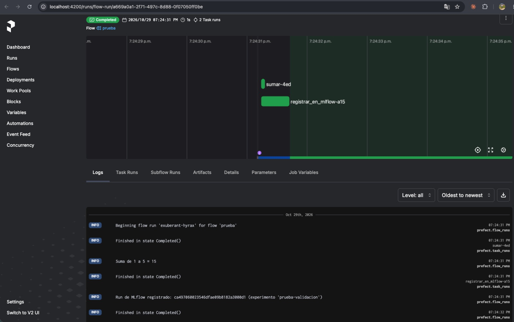
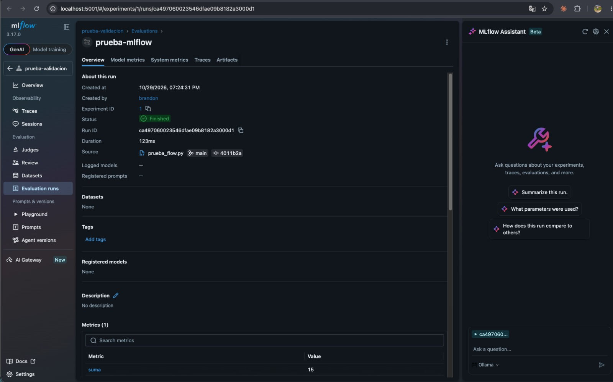
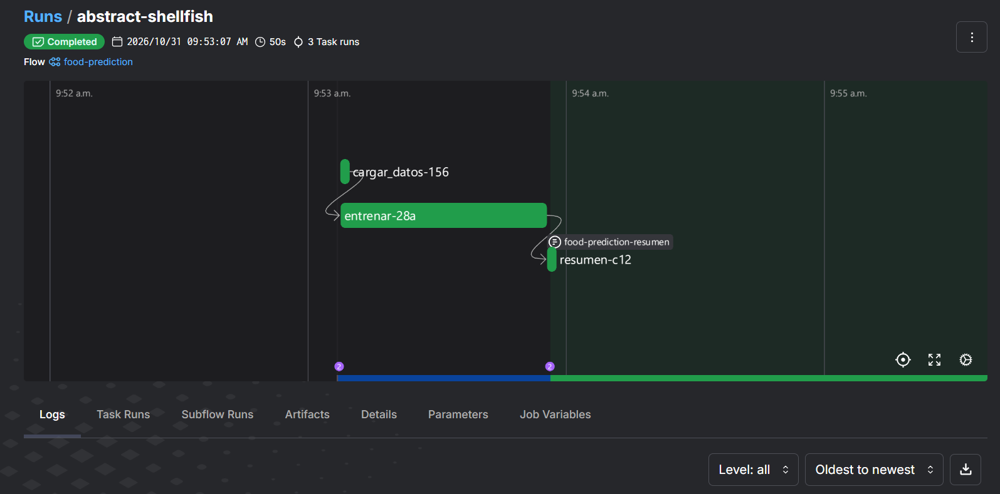
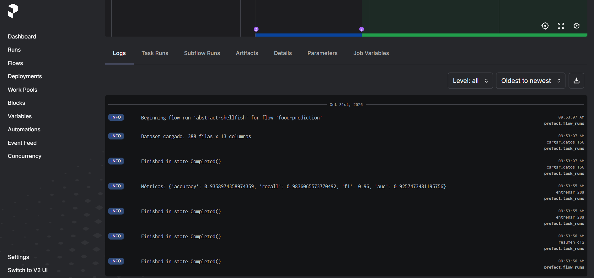
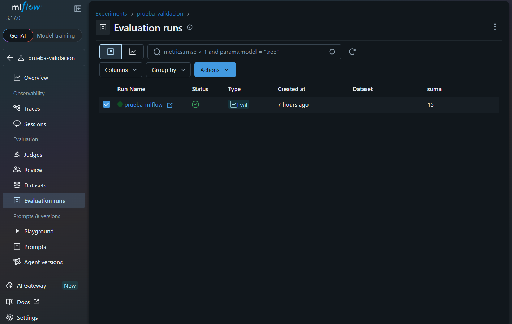
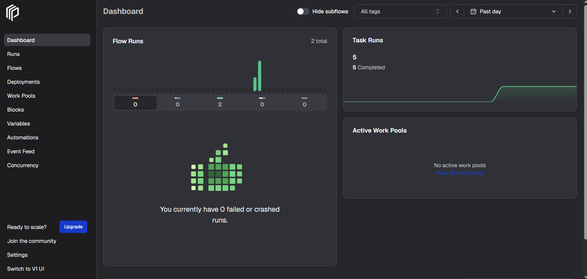
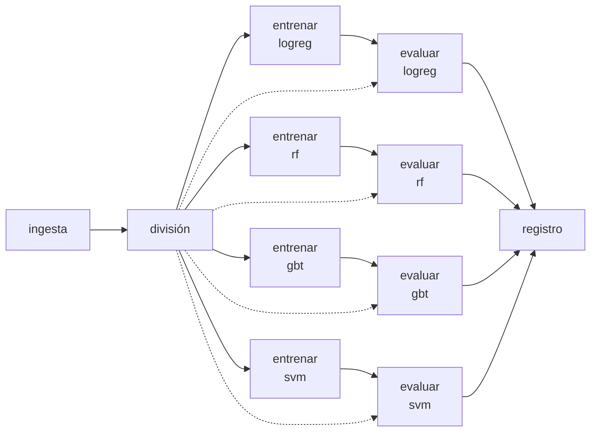

# MLOps Project: Online Food Ordering Behavior Prediction

Proyecto del curso de **MLOps** de la **Maestría en Ciencia de Datos (Universidad Santo Tomás)**. Implementa un flujo reproducible para predecir si un cliente vuelve a pedir (`Output`) con el dataset [Online Food Ordering Dataset](https://www.kaggle.com/datasets/srisyra02/online-food-ordering-dataset).

## Requisitos

| Herramienta | Versión | Comprobar |
|---|---|---|
| Python | 3.12 a 3.14 | `python --version` |
| Poetry | 2.x | `poetry --version` |
| Git | reciente | `git --version` |
| Docker Desktop | reciente | `docker --version` |

## Estructura

```text
mlops_food_prediction/
├── .github/workflows/tests.yml  # CI: pytest en cada push y Pull Request (A3)
├── api/main.py                  # API de FastAPI que sirve el modelo champion (A2)
├── configs/
│   ├── config.yaml              # Datos, candidatos, umbrales, MLflow, registro e inferencia
│   └── features.yaml            # Variables del experimento: ALL, NUMERIC o CUSTOM (A2)
├── data/
│   ├── raw/                     # CSV de Kaggle (no se versiona)
│   ├── processed/               # Datos transformados (no se versiona)
│   ├── predictions/             # Predicciones prediccion_<fecha-hora>.csv (no se versiona)
│   ├── lotes/                   # Copia de cada lote puntuado, con etiquetas reales (A3, no se versiona)
│   └── reportes_drift/          # Reportes HTML de Evidently y resúmenes JSON (A3, no se versiona)
├── docs/
│   ├── memoria-actividad-2.md   # Memoria 2
│   └── memoria-actividad-3.md   # Memoria 3 (A3)
├── flows/
│   ├── prueba_flow.py           # Flow de validación de Prefect + MLflow (A1)
│   ├── food_flow.py             # Pipeline opcional de la A1
│   ├── entrenamiento_flow.py    # Pipeline de entrenamiento (A2)
│   ├── inferencia_flow.py       # Pipeline de inferencia diaria, con drift emulado (A2 y A3)
│   ├── drift_features_flow.py   # Drift de features con Evidently (A3)
│   ├── drift_objetivo_flow.py   # Drift de evento: variable objetivo (A3)
│   └── desplegar.py             # Despliegues en Prefect (A2 y A3)
├── models/                      # Modelos locales (no se versiona)
├── notebooks/01_eda.ipynb       # Análisis exploratorio
├── services/                    # docker compose de MLflow (5000) y Prefect (4200)
├── src/
│   ├── load_data.py             # Cargue y validación del dataset
│   ├── datos.py                 # Partición train/test compartida y validación de datos (A3)
│   ├── drift.py                 # Emulación y detección de drift, sin Prefect ni MLflow (A3)
│   ├── inferencia.py            # Lote de prueba, puntuación y nombres de archivo (A3)
│   ├── modelo.py                # Variables, pipeline de sklearn, métricas y regla de promoción (A2)
│   ├── preprocessing.py
│   ├── train.py
│   └── evaluate.py
├── tests/                       # Pruebas con pytest: datos, modelo, inferencia, API y drift
├── pyproject.toml
└── poetry.lock
```

Cada carpeta lleva un `__init__.py` para que Git la versione aunque esté vacía.

## 1. Preparar el entorno

```powershell
git clone https://github.com/HilderBrandon/mlops_food_prediction.git
cd mlops_food_prediction
poetry env use 3.12   # o 3.13 / 3.14, la que tengas instalada
poetry install
poetry run python -c "import prefect, mlflow, sklearn; print('ok')"
```

`pyproject.toml` declara lo que se necesita y `poetry.lock` registra lo que se instaló. Si se cambian dependencias, se usa `poetry add "paquete==x.y.z"` y se suben ambos archivos. Si Poetry avisa de que el lock no coincide, `poetry lock` lo ejecuta solo quien cambió las dependencias.

> `fastapi` está fijado en 0.154.0 porque las versiones más nuevas rompen el servidor de Prefect 3.8.8 cuando se ejecuta sin Docker.

## 2. Datos

1. Se descarga el CSV desde [Kaggle](https://www.kaggle.com/datasets/srisyra02/online-food-ordering-dataset).
2. Se guarda como `data/raw/online food delivery dataset.csv` (388 filas).
3. Se comprueba el cargue:

```powershell
poetry run python src/load_data.py
```

`load_data()` elimina la columna sin nombre que crea la coma final de cada fila, valida que exista la columna objetivo `Output` y avisa si falta alguna columna esperada (lista en `configs/config.yaml`).

## 3. Levantar MLflow y Prefect

```powershell
cd services
docker compose up -d
cd ..
```

- MLflow: http://localhost:5000
- Prefect: http://localhost:4200

> **macOS:** el puerto 5000 lo ocupa el Receptor AirPlay. Se desactiva en Ajustes del Sistema → General → AirDrop y Handoff → Receptor AirPlay, o MLflow no podrá arrancar.

Si Docker no funciona, se usa la opción B de [services/README.md](services/README.md).

## 4. Validar los servicios con el flow de prueba

Desde la raíz del repositorio, en la misma terminal:

```powershell
$env:PREFECT_API_URL = "http://localhost:4200/api"
$env:MLFLOW_TRACKING_URI = "http://localhost:5000"
poetry run python flows/prueba_flow.py
```

En macOS/Linux: `export PREFECT_API_URL=http://localhost:4200/api` y `export MLFLOW_TRACKING_URI=http://localhost:5000`.

Resultado esperado:

- En http://localhost:4200/runs, el run del flow **prueba** queda en *Completed* y en sus logs aparece `Suma de 1 a 5 = 15`.
- En http://localhost:5000, el experimento **prueba-validacion** tiene un run **prueba-mlflow** con el parámetro `n` y la métrica `suma`.

Capturas de la ejecución:

| Prefect: flow *prueba* completado | MLflow: run *prueba-mlflow* |
|---|---|
|  |  |

## 5. Pipeline de entrenamiento (opcional)

Con las mismas variables de entorno y el CSV en `data/raw/`:

```powershell
poetry run python flows/food_flow.py
```

El flow **food-prediction** tiene tres tareas: cargar datos (registra filas y columnas en los logs y en MLflow), entrenar un RandomForest y registrar parámetros, métricas (accuracy, recall, f1, AUC) y modelo en el experimento `food-prediction` de MLflow, y crear en Prefect un artefacto Markdown con el resumen.

## 6. Resultados

Ejecución del flow **food-prediction** (dataset de 388 filas x 13 columnas) registrada en MLflow:

| Métrica | Valor |
|---|---|
| accuracy | 0.9359 |
| recall | 0.9836 |
| f1 | 0.9600 |
| AUC | 0.9257 |

Flow **food-prediction** en Prefect, con sus tres tareas (`cargar_datos-156`, `entrenar-28a` y `resumen-c12`):



Logs de la ejecución, con el dataset cargado y las métricas registradas:



Runs del experimento **prueba-validacion** en MLflow:



Panel de Prefect con las ejecuciones de los dos flows:



## 7. Actividad 2: pipelines, registro y API

Define las variables en cada terminal (en macOS, si MLflow está publicado en otro puerto por AirPlay, usa ese puerto, p. ej. `http://localhost:5001`):

```powershell
$env:PREFECT_API_URL = "http://localhost:4200/api"
$env:MLFLOW_TRACKING_URI = "http://localhost:5000"
```

`MLFLOW_TRACKING_URI` tiene prioridad sobre `mlflow.tracking_uri` de `configs/config.yaml`.

### 7.1 Entrenamiento

```powershell
poetry run python flows/entrenamiento_flow.py
```

Flow `entrenamiento-food`: **ingesta → división → entrenamiento → evaluación → registro**. Entrenamiento y evaluación se hacen por candidato, como tareas separadas de Prefect que corren en paralelo:




Grafo real en Prefect:


- Entrena cada modelo de `candidatos` (regresión logística, random forest, gradient boosting y SVM) con las variables de `configs/features.yaml`. Cada candidato se evalúa en su propia tarea.
- Cada candidato es un run en el experimento `food-prediction-mlops` con el tag `fase = entrenamiento`, sus parámetros (incluidos `features` y `n_features`), las métricas `auc`, `accuracy`, `precision`, `recall`, `f1` y el modelo.
- El mejor candidato solo se registra como versión nueva de `food-modelo` y recibe el alias `champion` si su AUC ≥ `registro.umbral_auc` **y** supera al champion actual en más de `registro.mejora_minima`. Si no, el run queda en MLflow y el alias no cambia.

Para cambiar las variables edita `seleccion` en `configs/features.yaml` (`ALL`, `NUMERIC` o `CUSTOM`).

#### Última ejecución (variables `CUSTOM`, 9 variables)

Ingesta de 388 filas × 13 columnas, con partición de 291 filas de train y 97 de test (77.32 % de positivos en test).

| Candidato | Algoritmo | AUC | Accuracy | Precision | Recall | F1 |
|---|---|---|---|---|---|---|
| **food-rf** 🏆 | random_forest | **0.9194** | 0.9072 | 0.9125 | 0.9733 | 0.9419 |
| food-svm | svm | 0.9055 | 0.8866 | 0.9103 | 0.9467 | 0.9281 |
| food-gbt | gradient_boosting | 0.8952 | 0.8866 | 0.9103 | 0.9467 | 0.9281 |
| food-logreg | logistic_regression | 0.8533 | 0.8969 | 0.9114 | 0.9600 | 0.9351 |

El mejor candidato fue `food-rf` (AUC 0.9194). Como no había champion previo, se registró como **versión 1** con alias `champion`, al superar el umbral de 0.8.

### 7.2 Inferencia

```powershell
poetry run python flows/inferencia_flow.py
```

Flow `inferencia-food`: carga `models:/food-modelo@champion`, toma un lote aleatorio de `inferencia.tamano_lote` clientes, guarda `data/predictions/prediccion_<fecha>.csv` y crea un run con tag `fase = inferencia`, `modelo_version` y `modelo_run_id`. Desde la A3 el lote sale de la parte de prueba y lleva drift emulado (ver 8.2).

### 7.3 Despliegues en Prefect

```powershell
poetry run python flows/desplegar.py
```

Registra `entrenamiento-food/entrenamiento-manual` (sin horario) e `inferencia-food/inferencia-diaria` (cron `0 6 * * *`, UTC). Deja la terminal abierta. Para lanzarlos a mano:

```powershell
poetry run prefect deployment run "entrenamiento-food/entrenamiento-manual"
poetry run prefect deployment run "inferencia-food/inferencia-diaria"
```

### 7.4 API

```powershell
poetry run uvicorn api.main:app --port 8000
```

- Docs: http://localhost:8000/docs · Estado: http://localhost:8000/health
- Si cambia el champion, reinicia la API.

Ejemplo (PowerShell):

```powershell
$cliente = @{
    Age = 22; Gender = "Female"; "Marital Status" = "Single"; Occupation = "Student"
    "Monthly Income" = "No Income"; "Educational Qualifications" = "Graduate"; "Family size" = 4
    "Customer Type" = "Frequent"; latitude = 12.9766; longitude = 77.5993; "Pin code" = 560001
} | ConvertTo-Json
Invoke-RestMethod -Uri http://localhost:8000/predict -Method Post -ContentType "application/json" -Body $cliente
```

Desde la A3, `Feedback` es opcional: el modelo ya no la usa porque no existe en el momento de predecir (ver sección 8.1).

Respuesta obtenida con el champion versión 2 de la A2 (que todavía usaba `Feedback`):

```json
{"probabilidad_output": 0.9807, "prediccion": 1, "vuelve_a_pedir": "Yes", "version_modelo": "2"}
```

## 8. Actividad 3: drift y tests

### 8.0 Dependencias nuevas

```powershell
poetry add "evidently==0.7.22"
poetry add --group dev httpx
```

Esto actualiza `pyproject.toml` y `poetry.lock`: se suben los dos. `httpx` lo necesita el `TestClient` de FastAPI.

### 8.1 Cambio por la retroalimentación de la A2: sin `Feedback`

`Feedback` es la opinión que el cliente deja **después** de pedir. En el momento de predecir si volverá a pedir no existe, así que usarla es fuga de información (*data leakage*) e infla el AUC.

- `configs/features.yaml` tiene una lista `excluidas` con `Feedback`. Esas variables nunca entran en `ALL` ni en `NUMERIC`, y `CUSTOM` falla si alguna aparece en la lista (`tests/test_modelo.py` lo comprueba).
- El modelo se registra con un nombre nuevo, `food-modelo-sin-feedback`. El champion anterior usaba `Feedback`, y su AUC no se puede comparar con el de un modelo sin esa variable.

Antes de la inferencia hay que volver a entrenar:

```powershell
poetry run python flows/entrenamiento_flow.py
```

### 8.2 Drift emulado en la inferencia

La inferencia ya no toma clientes al azar de todo el CSV. Ahora toma `inferencia.tamano_lote` filas de la **parte de prueba**: la misma partición del entrenamiento (`src/datos.py`), con clientes que el modelo no vio. Antes de predecir le aplica un drift controlado por `drift.nivel` en `configs/config.yaml`. El nivel no se pasa al ejecutar: se cambia en el YAML.

| Qué cambia | Cómo (con nivel `n`) | Con 0.6 |
|---|---|---|
| `Age` | la media sube `n × 2` desviaciones estándar | +1,2 desviaciones (≈ +3,5 años) |
| `Family size` | la media sube `n × 1` desviación estándar | +0,6 desviaciones (≈ +1 persona) |
| `Occupation` | una fracción `n` de filas pasa a `Employee` | 60 % de las filas |
| `Monthly Income` | una fracción `n` de filas pasa a `More than 50000` | 60 % de las filas |
| `Output` (objetivo) | una fracción `n × 0,5` de los `Yes` pasa a `No` | 30 % de los `Yes` |

El escenario es que empiezan a llegar clientes mayores, empleados y con más ingresos, y vuelven a pedir menos. Con `nivel: 0.0` el lote no cambia. `drift.semilla: 42` hace que los tres niveles usen los mismos 50 clientes, así que las diferencias vienen solo del drift.

Cada ejecución guarda:

- `data/lotes/lote_<fecha-hora>_nivel-<n>.csv`: el lote puntuado **con la etiqueta real** `Output`, para los pipelines de drift.
- `data/predictions/prediccion_<fecha-hora>.csv`: las predicciones, **sin** la etiqueta, como en producción.

Para correr los tres niveles se cambia `drift.nivel` y se ejecuta la inferencia cada vez:

```powershell
# drift.nivel: 0.0  ->  luego 0.3  ->  luego 0.6
poetry run python flows/inferencia_flow.py
```

### 8.3 Pipelines de detección de drift

Los dos comparan un lote (por defecto, el último de `data/lotes/`) con la **parte de entrenamiento**.

```powershell
poetry run python flows/drift_features_flow.py                                  # último lote
poetry run python flows/drift_objetivo_flow.py data/lotes/lote_<...>_nivel-0.6.csv  # un lote concreto
```

| Pipeline | Qué compara | Prueba | Salida |
|---|---|---|---|
| `drift-features` | distribución de cada variable de entrada del modelo | Evidently `DataDriftPreset`: Kolmogorov-Smirnov (numéricas) y chi-cuadrado (categóricas), p < `drift.umbral_test` | `data/reportes_drift/<lote>_features.html` (reporte de Evidently) y `_features.json` |
| `drift-objetivo` | tasa de `Output = Yes` | chi-cuadrado 2×2, p < `drift.alpha_objetivo` | `data/reportes_drift/<lote>_objetivo.json` |

- **Alerta:** si la fracción de variables con drift **supera** `drift.umbral_fraccion` (0.3), el flow escribe un `WARNING` con `ALERTA de drift de features` en el log de Prefect y lo deja en su artefacto. El drift de evento alerta igual cuando el p-valor baja de `alpha_objetivo`.
- **Lotes sin etiquetas:** en producción la etiqueta real llega días después. Si el lote no trae `Output`, o la trae vacía, `drift-objetivo` falla con el mensaje *"El lote no trae etiquetas reales…"*. Si faltan solo algunas, compara las disponibles y lo avisa en el log.
- Cada ejecución crea un run en MLflow con `fase = drift-features` o `fase = drift-objetivo`, y con la fracción, las tasas, el p-valor y los reportes.
- `desplegar.py` también registra `drift-features-diario` y `drift-objetivo-diario`, con cron `30 6 * * *` (30 minutos después de la inferencia).

## Pruebas

```powershell
poetry run pytest
```

No necesitan MLflow, Prefect ni el CSV: la lógica está en `src/` y la API se prueba con un modelo falso (`monkeypatch` sobre `cargar_champion`). Los tests que usan el CSV real se saltan si no está en `data/raw/`.

| Archivo | Qué prueba |
|---|---|
| `tests/test_datos.py` | esquema, nulos, rangos, valores permitidos, partición reproducible y estratificada |
| `tests/test_load_data.py` | cargue del CSV |
| `tests/test_modelo.py` | selección de variables (incluida la exclusión de `Feedback`), los 4 modelos y la regla de promoción |
| `tests/test_inferencia.py` | el lote sale solo de la parte de prueba, puntuación y nombres de archivo |
| `tests/test_api.py` | `/health`, `/predict`, validación de entradas (422) y API sin modelo (503) |
| `tests/test_drift.py` | emulación por nivel, lectura del resultado de Evidently, umbral y alerta, rechazo de lotes sin etiquetas, drift de evento y una prueba con Evidently real: 0.0 no alerta y 0.6 sí |

**CI:** `.github/workflows/tests.yml` ejecuta `poetry run pytest` en GitHub Actions en cada push a `main` y en cada Pull Request.
