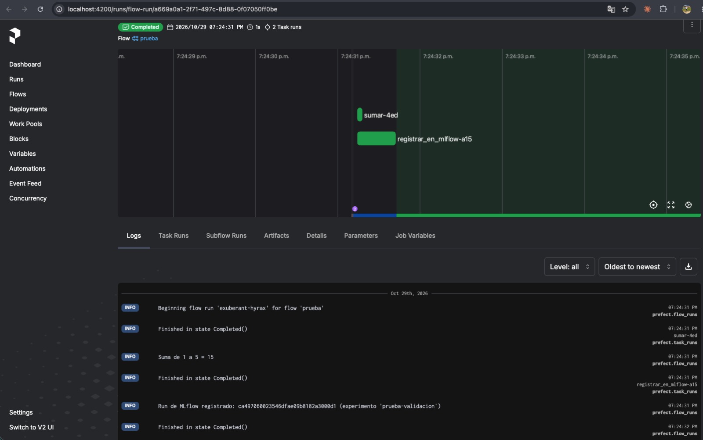
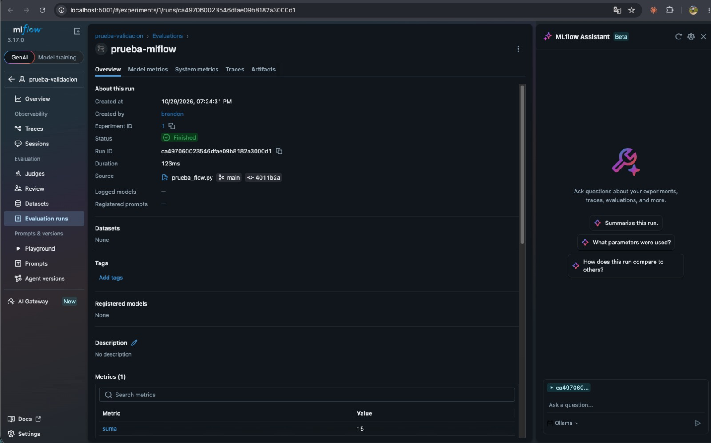
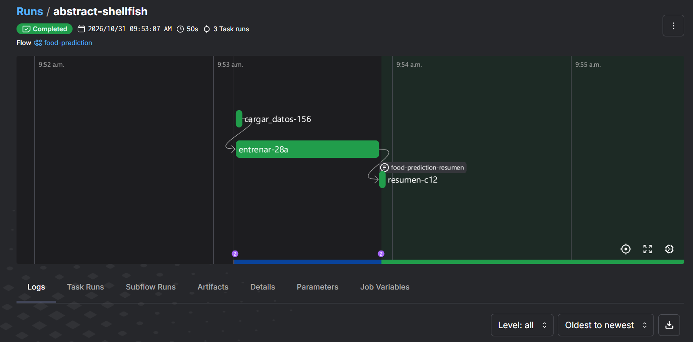
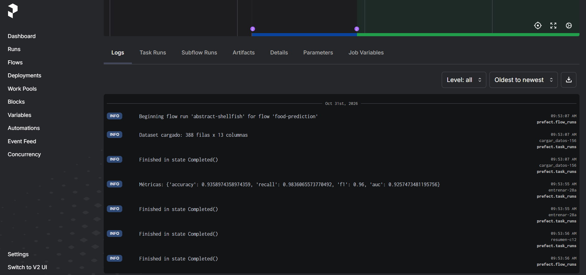
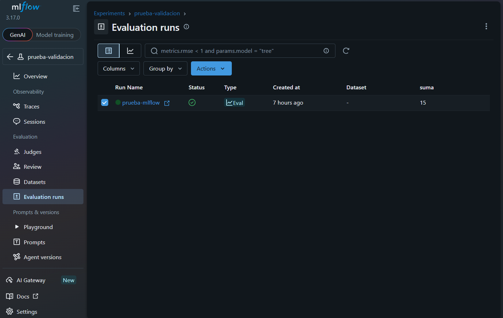
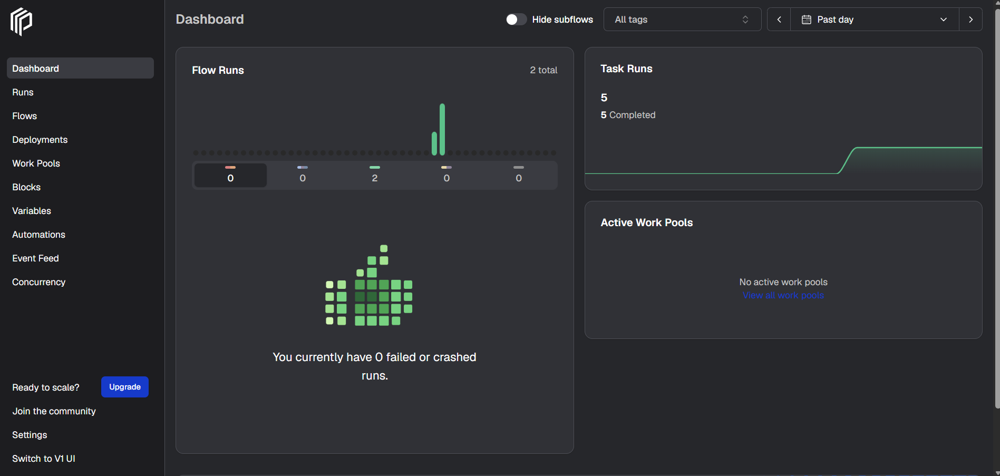
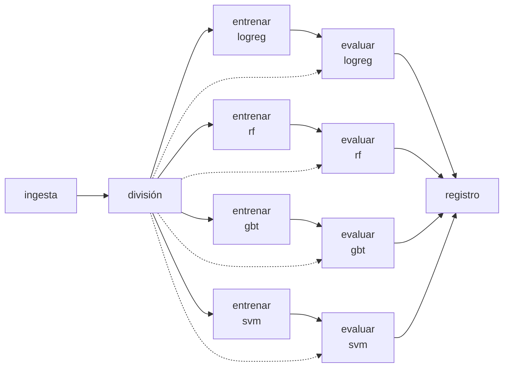

# MLOps Project: Online Food Ordering Behavior Prediction

Proyecto del curso de **MLOps** de la **Maestría en Ciencia de Datos (Universidad Santo Tomás)**. Implementa un flujo reproducible para predecir si un cliente vuelve a pedir (`Output`) con el dataset [Online Food Ordering Dataset](https://www.kaggle.com/datasets/srisyra02/online-food-ordering-dataset).

## Requisitos

| Herramienta | Versión | Comprobar |
|---|---|---|
| Python | 3.12 a 3.14 | `python --version` |
| Poetry | 2.x | `poetry --version` |
| Git | reciente | `git --version` |
| Docker Desktop | reciente | `docker --version` |

## Estructura

```text
mlops_food_prediction/
├── api/main.py                  # API de FastAPI que sirve el modelo champion (A2)
├── configs/
│   ├── config.yaml              # Datos, candidatos, umbrales, MLflow, registro e inferencia
│   └── features.yaml            # Variables del experimento: ALL, NUMERIC o CUSTOM (A2)
├── data/
│   ├── raw/                     # CSV de Kaggle (no se versiona)
│   ├── processed/               # Datos transformados (no se versiona)
│   └── predictions/             # Predicciones diarias prediccion_<fecha>.csv (no se versiona)
├── docs/memoria-actividad-2.md  # Borrador de la memoria 2
├── flows/
│   ├── prueba_flow.py           # Flow de validación de Prefect + MLflow (A1)
│   ├── food_flow.py             # Pipeline opcional de la A1
│   ├── entrenamiento_flow.py    # Pipeline de entrenamiento (A2)
│   ├── inferencia_flow.py       # Pipeline de inferencia diaria (A2)
│   └── desplegar.py             # Despliegues en Prefect (A2)
├── models/                      # Modelos locales (no se versiona)
├── notebooks/01_eda.ipynb       # Análisis exploratorio
├── services/                    # docker compose de MLflow (5000) y Prefect (4200)
├── src/
│   ├── load_data.py             # Cargue y validación del dataset
│   ├── modelo.py                # Variables, pipeline de sklearn, métricas y regla de promoción (A2)
│   ├── preprocessing.py
│   ├── train.py
│   └── evaluate.py
├── tests/                       # Pruebas con pytest
├── pyproject.toml
└── poetry.lock
```

Cada carpeta lleva un `__init__.py` para que Git la versione aunque esté vacía.

## 1. Preparar el entorno

```powershell
git clone https://github.com/HilderBrandon/mlops_food_prediction.git
cd mlops_food_prediction
poetry env use 3.12   # o 3.13 / 3.14, la que tengas instalada
poetry install
poetry run python -c "import prefect, mlflow, sklearn; print('ok')"
```

`pyproject.toml` declara lo que se necesita y `poetry.lock` registra lo que se instaló. Si se cambian dependencias, se usa `poetry add "paquete==x.y.z"` y se suben ambos archivos. Si Poetry avisa de que el lock no coincide, `poetry lock` lo ejecuta solo quien cambió las dependencias.

> `fastapi` está fijado en 0.154.0 porque las versiones más nuevas rompen el servidor de Prefect 3.8.8 cuando se ejecuta sin Docker.

## 2. Datos

1. Se descarga el CSV desde [Kaggle](https://www.kaggle.com/datasets/srisyra02/online-food-ordering-dataset).
2. Se guarda como `data/raw/online food delivery dataset.csv` (388 filas).
3. Se comprueba el cargue:

```powershell
poetry run python src/load_data.py
```

`load_data()` elimina la columna sin nombre que crea la coma final de cada fila, valida que exista la columna objetivo `Output` y avisa si falta alguna columna esperada (lista en `configs/config.yaml`).

## 3. Levantar MLflow y Prefect

```powershell
cd services
docker compose up -d
cd ..
```

- MLflow: http://localhost:5000
- Prefect: http://localhost:4200

> **macOS:** el puerto 5000 lo ocupa el Receptor AirPlay. Se desactiva en Ajustes del Sistema → General → AirDrop y Handoff → Receptor AirPlay, o MLflow no podrá arrancar.

Si Docker no funciona, se usa la opción B de [services/README.md](services/README.md).

## 4. Validar los servicios con el flow de prueba

Desde la raíz del repositorio, en la misma terminal:

```powershell
$env:PREFECT_API_URL = "http://localhost:4200/api"
$env:MLFLOW_TRACKING_URI = "http://localhost:5000"
poetry run python flows/prueba_flow.py
```

En macOS/Linux: `export PREFECT_API_URL=http://localhost:4200/api` y `export MLFLOW_TRACKING_URI=http://localhost:5000`.

Resultado esperado:

- En http://localhost:4200/runs, el run del flow **prueba** queda en *Completed* y en sus logs aparece `Suma de 1 a 5 = 15`.
- En http://localhost:5000, el experimento **prueba-validacion** tiene un run **prueba-mlflow** con el parámetro `n` y la métrica `suma`.

Capturas de la ejecución:

| Prefect: flow *prueba* completado | MLflow: run *prueba-mlflow* |
|---|---|
|  |  |

## 5. Pipeline de entrenamiento (opcional)

Con las mismas variables de entorno y el CSV en `data/raw/`:

```powershell
poetry run python flows/food_flow.py
```

El flow **food-prediction** tiene tres tareas: cargar datos (registra filas y columnas en los logs y en MLflow), entrenar un RandomForest y registrar parámetros, métricas (accuracy, recall, f1, AUC) y modelo en el experimento `food-prediction` de MLflow, y crear en Prefect un artefacto Markdown con el resumen.

## 6. Resultados

Ejecución del flow **food-prediction** (dataset de 388 filas x 13 columnas) registrada en MLflow:

| Métrica | Valor |
|---|---|
| accuracy | 0.9359 |
| recall | 0.9836 |
| f1 | 0.9600 |
| AUC | 0.9257 |

Flow **food-prediction** en Prefect, con sus tres tareas (`cargar_datos-156`, `entrenar-28a` y `resumen-c12`):



Logs de la ejecución, con el dataset cargado y las métricas registradas:



Runs del experimento **prueba-validacion** en MLflow:



Panel de Prefect con las ejecuciones de los dos flows:



## 7. Actividad 2: pipelines, registro y API

Define las variables en cada terminal (en macOS, si MLflow está publicado en otro puerto por AirPlay, usa ese puerto, p. ej. `http://localhost:5001`):

```powershell
$env:PREFECT_API_URL = "http://localhost:4200/api"
$env:MLFLOW_TRACKING_URI = "http://localhost:5000"
```

`MLFLOW_TRACKING_URI` tiene prioridad sobre `mlflow.tracking_uri` de `configs/config.yaml`.

### 7.1 Entrenamiento

```powershell
poetry run python flows/entrenamiento_flow.py
```

Flow `entrenamiento-food`: **ingesta → división → entrenamiento → evaluación → registro**. Entrenamiento y evaluación se hacen por candidato, como tareas separadas de Prefect que corren en paralelo:




Grafo real en Prefect:


- Entrena cada modelo de `candidatos` (regresión logística, random forest, gradient boosting y SVM) con las variables de `configs/features.yaml`. Cada candidato se evalúa en su propia tarea.
- Cada candidato es un run en el experimento `food-prediction-mlops` con el tag `fase = entrenamiento`, sus parámetros (incluidos `features` y `n_features`), las métricas `auc`, `accuracy`, `precision`, `recall`, `f1` y el modelo.
- El mejor candidato solo se registra como versión nueva de `food-modelo` y recibe el alias `champion` si su AUC ≥ `registro.umbral_auc` **y** supera al champion actual en más de `registro.mejora_minima`. Si no, el run queda en MLflow y el alias no cambia.

Para cambiar las variables edita `seleccion` en `configs/features.yaml` (`ALL`, `NUMERIC` o `CUSTOM`).

#### Última ejecución (variables `CUSTOM`, 9 variables)

Ingesta de 388 filas × 13 columnas, con partición de 291 filas de train y 97 de test (77.32 % de positivos en test).

| Candidato | Algoritmo | AUC | Accuracy | Precision | Recall | F1 |
|---|---|---|---|---|---|---|
| **food-rf** 🏆 | random_forest | **0.9194** | 0.9072 | 0.9125 | 0.9733 | 0.9419 |
| food-svm | svm | 0.9055 | 0.8866 | 0.9103 | 0.9467 | 0.9281 |
| food-gbt | gradient_boosting | 0.8952 | 0.8866 | 0.9103 | 0.9467 | 0.9281 |
| food-logreg | logistic_regression | 0.8533 | 0.8969 | 0.9114 | 0.9600 | 0.9351 |

El mejor candidato fue `food-rf` (AUC 0.9194). Como no había champion previo, se registró como **versión 1** con alias `champion`, al superar el umbral de 0.8.

### 7.2 Inferencia

```powershell
poetry run python flows/inferencia_flow.py
```

Flow `inferencia-food`: carga `models:/food-modelo@champion`, toma un lote aleatorio de `inferencia.tamano_lote` clientes, guarda `data/predictions/prediccion_<fecha>.csv` y crea un run con tag `fase = inferencia`, `modelo_version` y `modelo_run_id`.

### 7.3 Despliegues en Prefect

```powershell
poetry run python flows/desplegar.py
```

Registra `entrenamiento-food/entrenamiento-manual` (sin horario) e `inferencia-food/inferencia-diaria` (cron `0 6 * * *`, UTC). Deja la terminal abierta. Para lanzarlos a mano:

```powershell
poetry run prefect deployment run "entrenamiento-food/entrenamiento-manual"
poetry run prefect deployment run "inferencia-food/inferencia-diaria"
```

### 7.4 API

```powershell
poetry run uvicorn api.main:app --port 8000
```

- Docs: http://localhost:8000/docs · Estado: http://localhost:8000/health
- Si cambia el champion, reinicia la API.

Ejemplo (PowerShell):

```powershell
$cliente = @{
    Age = 22; Gender = "Female"; "Marital Status" = "Single"; Occupation = "Student"
    "Monthly Income" = "No Income"; "Educational Qualifications" = "Graduate"; "Family size" = 4
    "Customer Type" = "Frequent"; latitude = 12.9766; longitude = 77.5993; "Pin code" = 560001
    Feedback = "Positive"
} | ConvertTo-Json
Invoke-RestMethod -Uri http://localhost:8000/predict -Method Post -ContentType "application/json" -Body $cliente
```

Respuesta obtenida con el champion versión 2:

```json
{"probabilidad_output": 0.9807, "prediccion": 1, "vuelve_a_pedir": "Yes", "version_modelo": "2"}
```

## Pruebas

```powershell
poetry run pytest
```
