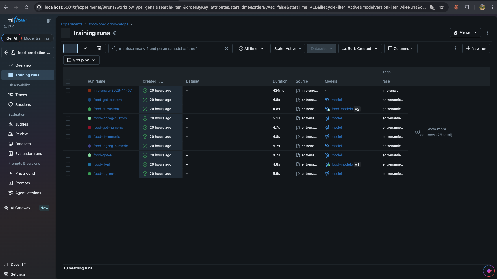
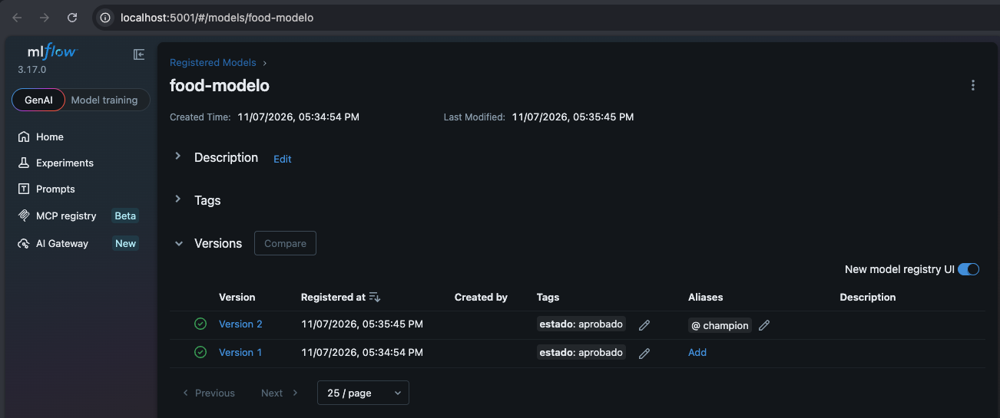
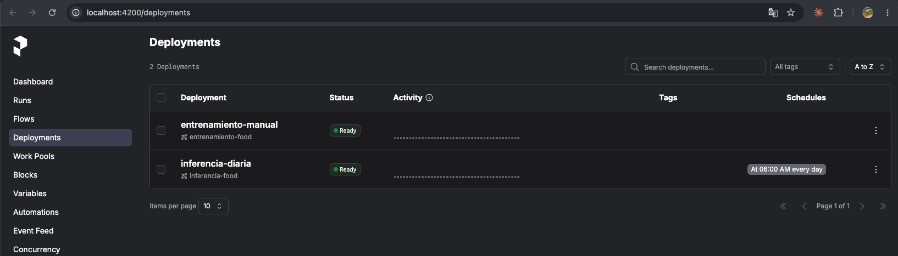
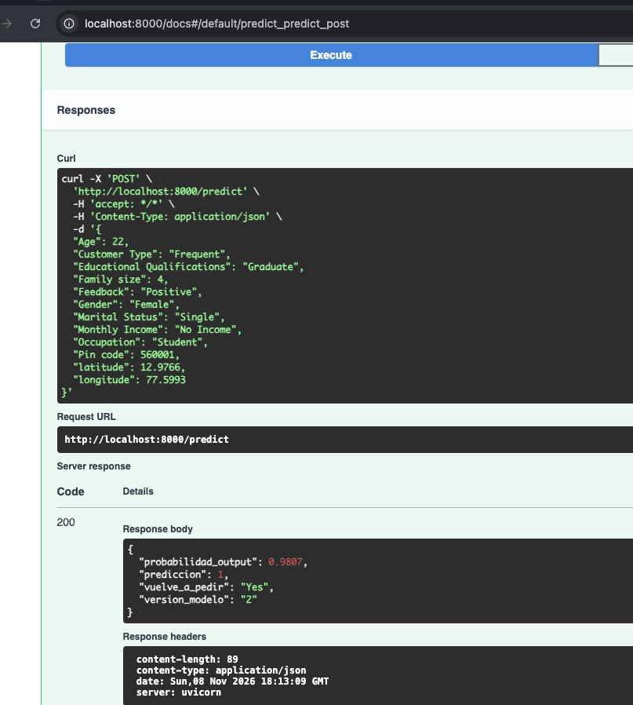

# Memoria 2: Pipeline y empaquetado

**Proyecto:** Online Food Ordering Behavior Prediction · **Integrantes:** Brandon Galvis, Johan Sebastian Cuellar · **Repositorio:** https://github.com/HilderBrandon/mlops_food_prediction

## 1. Objetivo

Pasar del flow de entrenamiento de la actividad 1 a un sistema con dos pipelines en Prefect, entrenamiento e inferencia, conectadas por el Model Registry de MLflow mediante el alias `champion`, y servir ese modelo con una API de FastAPI. El caso de uso es predecir si un cliente vuelve a pedir comida en línea (`Output = Yes`) con el dataset de Kaggle *Online Food Ordering* (388 filas, 78 % positivos).

## 2. Descripción del trabajo

1. **Configuración separada del código.** `configs/config.yaml` contiene datos, división train/test, candidatos con sus hiperparámetros, umbral de clasificación, experimento de MLflow, nombre del modelo, umbral de AUC, mejora mínima, tamaño de lote, carpeta de salida y cron. `configs/features.yaml` elige las variables con `seleccion: ALL | NUMERIC | CUSTOM`.
2. **Lógica del modelo** en `src/modelo.py`, sin Prefect ni MLflow: resolución de variables, pipeline de sklearn (escalado + one-hot + estimador), métricas y regla de promoción. Tiene pruebas unitarias en `tests/test_modelo.py`.
3. **Pipeline de entrenamiento** (`flows/entrenamiento_flow.py`, flow `entrenamiento-food`): `ingesta → dividir → entrenar → evaluar → registrar`. Cada candidato crea un run con tag `fase = entrenamiento`, parámetros (`features`, `n_features`, hiperparámetros, semilla), métricas y el modelo. El mejor candidato solo se registra si supera el AUC mínimo y al champion vigente.
4. **Pipeline de inferencia** (`flows/inferencia_flow.py`, flow `inferencia-food`): carga `models:/food-modelo@champion`, puntúa un lote aleatorio que simula clientes nuevos, guarda `data/predictions/prediccion_<fecha>.csv` y registra un run `fase = inferencia` con la versión y el run de entrenamiento del modelo usado.
5. **Despliegues** (`flows/desplegar.py`): `entrenamiento-food/entrenamiento-manual` sin horario e `inferencia-food/inferencia-diaria` con cron `0 6 * * *`.
6. **API** (`api/main.py`): carga el champion al arrancar y expone `GET /health` y `POST /predict`.

```text
api/main.py · configs/{config,features}.yaml · flows/{entrenamiento,inferencia}_flow.py · flows/desplegar.py · src/modelo.py · tests/test_modelo.py
```

## 3. Decisiones técnicas

| Decisión | Alternativas | Justificación |
|---|---|---|
| Métrica de promoción: AUC | Accuracy, F1 | Las clases están desbalanceadas (78/22). El AUC no depende del umbral y la accuracy de un modelo que siempre dice "Yes" ya es 0,78. |
| Umbral AUC 0,80 y `mejora_minima` configurable | Solo comparar con el champion | Evita promover modelos malos cuando no hay champion y permite exigir mejoras mínimas para no cambiar el modelo por ruido. |
| Varios candidatos por ejecución; solo el mejor compite | Un único modelo | Con 388 filas el entrenamiento es barato y la comparación queda trazada en MLflow. |
| Registrar versión solo si se promueve | Registrar siempre y mover el alias | Lo pide la actividad y mantiene el registry limpio: cada versión fue champion alguna vez. |
| Rutas resueltas desde la raíz del repo (`Path(__file__)`) | Rutas relativas al directorio actual | Los flows y la API funcionan aunque se lancen desde otra carpeta o desde Prefect. |
| Inferencia con `modelo.feature_names_in_` | Leer `features.yaml` | La inferencia usa las columnas del champion aunque `features.yaml` cambie después. |
| División estratificada, `test_size` 0,25 | 0,2 sin estratificar | Con pocos negativos, estratificar garantiza que el test tenga ambas clases (97 filas, ~22 negativos). |
| `cache_policy=NO_CACHE` en las tasks | Caché por defecto de Prefect | Las entradas son DataFrames y modelos; no tiene sentido cachearlos y evita avisos de hashing. |

## 4. Evidencias

**MLflow, experimento `food-prediction-mlops`.** Los 9 runs de entrenamiento (3 candidatos × ALL, NUMERIC y CUSTOM) tienen el tag `fase = entrenamiento`, y el run `inferencia-2026-11-07` tiene `fase = inferencia`. En la columna *Models* se ve que solo `food-rf-all` (v1) y `food-rf-custom` (v2) llegaron al registro.



**MLflow, Model Registry.** `food-modelo` tiene dos versiones con el tag `estado = aprobado`, y el alias `champion` apunta a la versión 2.



**Prefect, despliegues.** `entrenamiento-manual` (flow `entrenamiento-food`) no tiene horario e `inferencia-diaria` (flow `inferencia-food`) se ejecuta *At 06:00 AM every day*. Los dos están en estado *Ready*.



**API.** Llamada a `POST /predict` desde Swagger (`/docs`). La respuesta es 200 y el modelo usado es la versión 2.



## 5. Resultados

Métricas en test (97 filas) con `random_state = 42`:

| Features | Candidato | AUC | Accuracy | F1 |
|---|---|---|---|---|
| ALL (12) | Regresión logística | 0,873 | 0,897 | 0,935 |
| ALL (12) | **Random forest** | **0,914** | 0,918 | 0,949 |
| ALL (12) | Gradient boosting | 0,906 | 0,918 | 0,948 |
| NUMERIC (5) | Regresión logística | 0,745 | 0,773 | 0,869 |
| NUMERIC (5) | **Random forest** | **0,882** | 0,814 | 0,889 |
| NUMERIC (5) | Gradient boosting | 0,818 | 0,794 | 0,875 |
| CUSTOM (9) | Regresión logística | 0,853 | 0,897 | 0,935 |
| CUSTOM (9) | **Random forest** | **0,919** | 0,907 | 0,942 |
| CUSTOM (9) | Gradient boosting | 0,895 | 0,887 | 0,928 |

Evolución del champion:

| Ejecución | Mejor AUC | Champion previo | Resultado |
|---|---|---|---|
| 1 · ALL | 0,9139 | ninguno | Versión 1 → `champion` |
| 2 · NUMERIC | 0,8818 | v1 (0,9139) | No supera al champion: alias sin cambios |
| 3 · CUSTOM | 0,9194 | v1 (0,9139) | Versión 2 → `champion` |

Así se cumple el criterio de éxito: una nueva ejecución generó la versión 2, el alias pasó a ella y, al reiniciar la API, `/health` devuelve `"version": "2"` sin cambiar código.

Inferencia: lote de 50 clientes guardado en `data/predictions/prediccion_2026-11-07.csv`, con la versión 2.

Predicción de ejemplo de la API:

```json
POST /predict
{"Age": 22, "Gender": "Female", "Marital Status": "Single", "Occupation": "Student",
 "Monthly Income": "No Income", "Educational Qualifications": "Graduate", "Family size": 4,
 "Customer Type": "Frequent", "latitude": 12.9766, "longitude": 77.5993, "Pin code": 560001,
 "Feedback": "Positive"}

→ {"probabilidad_output": 0.9807, "prediccion": 1, "vuelve_a_pedir": "Yes", "version_modelo": "2"}
```

Un cliente casado, empleado, con ingresos altos y feedback negativo obtuvo 0,192 (`"No"`).

**Lectura:** las variables categóricas aportan mucho (NUMERIC cae a 0,88). Quitar ubicación (`latitude`, `longitude`, `Pin code`) en CUSTOM no empeora e incluso mejora ligeramente el AUC, lo que sugiere que esas variables añaden ruido. Con solo 97 filas de test, diferencias de ~0,005 en AUC están dentro de la variación esperable; por eso se dejó `mejora_minima` configurable.

## 6. Problemas encontrados

| Problema | Causa | Solución |
|---|---|---|
| La API no arrancaba: `MlflowException ... failed with error code 403` al cargar `models:/food-modelo@champion` | En esa terminal no estaba definida `MLFLOW_TRACKING_URI`, así que se usó `http://localhost:5000` de `config.yaml`. En macOS ese puerto lo ocupa el Receptor AirPlay (respondía `AirTunes`), no MLflow. | MLflow se publica en el puerto 5001 y se define `MLFLOW_TRACKING_URI=http://localhost:5001` en cada terminal (se añadió a `~/.zshrc`). No se cambió el YAML para no romper la configuración del resto del curso, que usa el 5000. |
| `zsh: command not found: poetry` | Poetry estaba instalado en `~/Library/Python/3.14/bin`, que no estaba en el `PATH`. | Se añadió esa carpeta al `PATH` en `~/.zshrc`. El entorno virtual y sus dependencias ya existían. |
| `git pull` abortaba: "los cambios locales de README.md serán sobrescritos" | En GitHub había commits nuevos de la actividad 1 (capturas y sección de resultados) que también modificaban el `README.md`. | `git stash -u`, `git pull`, `git stash pop` y resolución manual del conflicto conservando las dos secciones (resultados de la A1 y la nueva sección 7 de la A2). |
| `MlflowException: The saved sklearn model references untrusted types` al registrar random forest y gradient boosting | MLflow 3 serializa con skops y no confía por defecto en `sklearn.tree._tree.Tree`. | Se pasa `skops_trusted_types=["sklearn.tree._tree.Tree"]` en `log_model`, porque son modelos entrenados por el propio pipeline. |
| Al cerrar la terminal de `desplegar.py` los despliegues quedan pausados | `serve()` ejecuta los despliegues dentro de ese proceso. | La terminal debe quedar abierta. Con más tiempo se usaría un work pool con un worker. |
| Aviso de MLflow sobre columnas enteras al inferir la firma | Las columnas enteras no admiten nulos en el esquema. | Es solo informativo: el dataset no tiene nulos. |

## 7. Conclusiones

La separación en `src/` (lógica), `flows/` (orquestación), `configs/` (parámetros) y `api/` (servicio) permite cambiar modelos, variables y umbrales sin tocar código, y el alias `champion` desacopla el entrenamiento del consumo. Con más tiempo: validación cruzada en vez de un único split (el test es pequeño), recarga del champion en la API sin reiniciar, ingesta de datos realmente nuevos, monitoreo de drift (actividad siguiente) y un worker/work pool en lugar de `serve` para no depender de una terminal abierta.

## 8. Uso de herramientas de IA

**Herramienta:** Claude Code (asistente de programación de Anthropic) en la app de escritorio de Claude.

**Para qué se usó:**

- Leer el enunciado y el ejemplo de referencia del curso (`actividades/actividad-2/`) y adaptarlos al caso de pedidos de comida, sin copiar el ejemplo de churn.
- Escribir el código: `src/modelo.py`, los flows de entrenamiento, inferencia y despliegue, la API, `features.yaml`, las pruebas en `tests/test_modelo.py` y la sección de la actividad 2 del README.
- Ejecutar una primera prueba de extremo a extremo contra los servicios locales y redactar el borrador de esta memoria con las métricas obtenidas.
- Diagnosticar errores durante la ejecución: el error 403 del puerto 5000, `poetry` fuera del `PATH` y el conflicto de Git en el `README.md`.

**Qué se hizo sin IA:**

- La elección del dataset y del caso de uso (Online Food Ordering de Kaggle), que viene de la actividad 1.
- La ejecución de los flows, los despliegues y la API en el equipo propio, la toma de las capturas de la sección 4 y la gestión del repositorio: ramas, commits, push y Pull Requests en GitHub, hechos a mano siguiendo instrucciones paso a paso.
- La revisión de los resultados: comprobar en las UIs de MLflow y Prefect que los runs, el alias `champion` y los despliegues eran los esperados, y validar las métricas y la elección de `CUSTOM` como conjunto de variables del champion.

**Qué se revisó o corrigió de las salidas de la IA:**

- Se comprobó en MLflow que solo los modelos promovidos (v1 y v2) quedaran en el Model Registry y que el run con NUMERIC no cambiara el alias, como pide la actividad.
- Se verificó que la API respondiera con la versión 2 después de cambiar el champion, sin modificar código.
- Se descartó la propuesta de cambiar `tracking_uri` a `5001` en `config.yaml`: el problema era solo de este equipo con macOS, así que se resolvió con la variable de entorno.
- Se corrigió el orden de las capturas al enlazarlas en la memoria (runs de MLflow frente a Model Registry).

**Contribución individual:**

| Integrante | Contribución |
|---|---|
| Brandon Galvis | Definió el caso de uso. Guio el desarrollo con Claude Code. Ejecutó y validó los flows, los despliegues y la API en su equipo. Tomó las capturas y gestionó el repositorio (ramas, commits y Pull Requests). |
| Johan Sebastian Cuellar | Revisó los detalles de la implementación y de esta memoria, y se encarga de la entrega final. |

La IA generó el código y el borrador de la memoria. El grupo ejecutó, validó y revisó el resultado.
