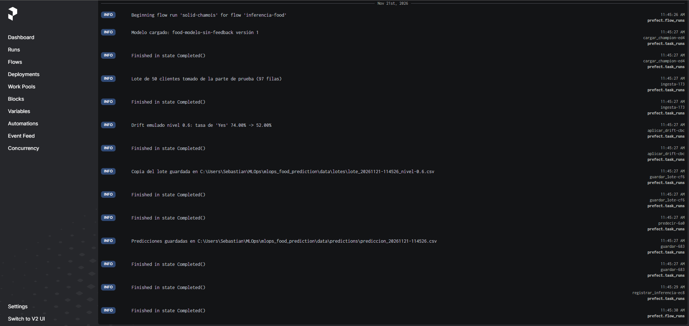
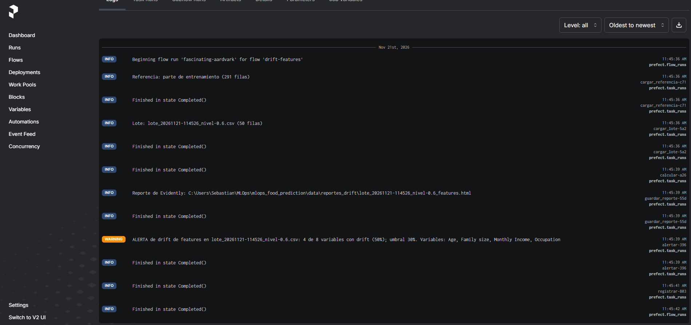
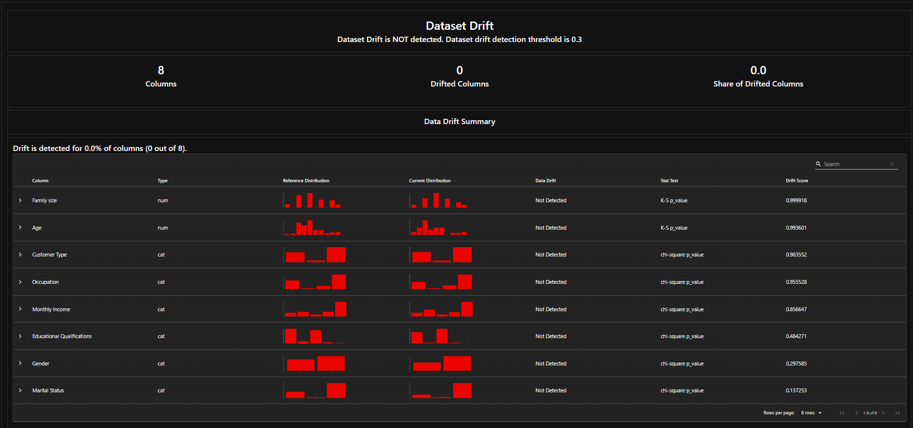
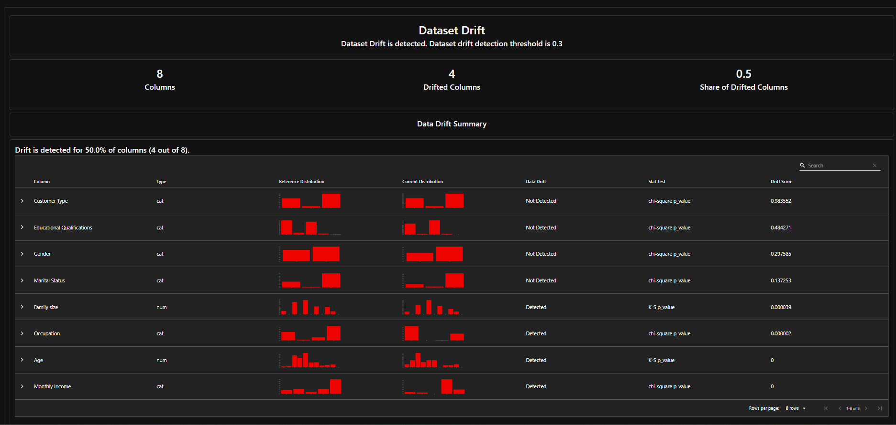
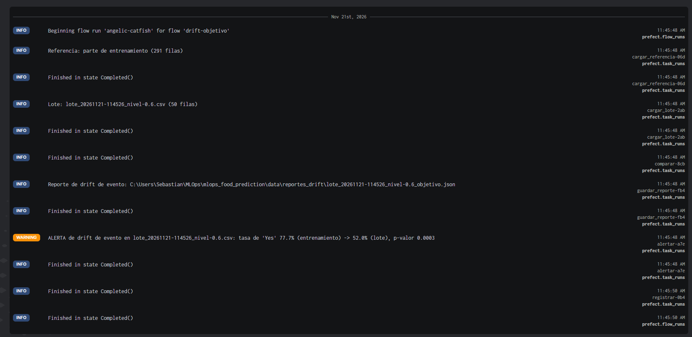
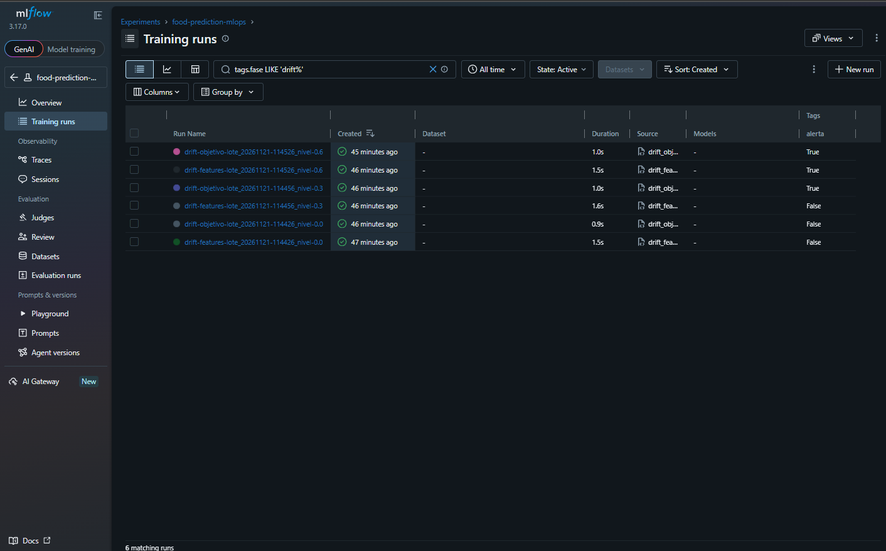
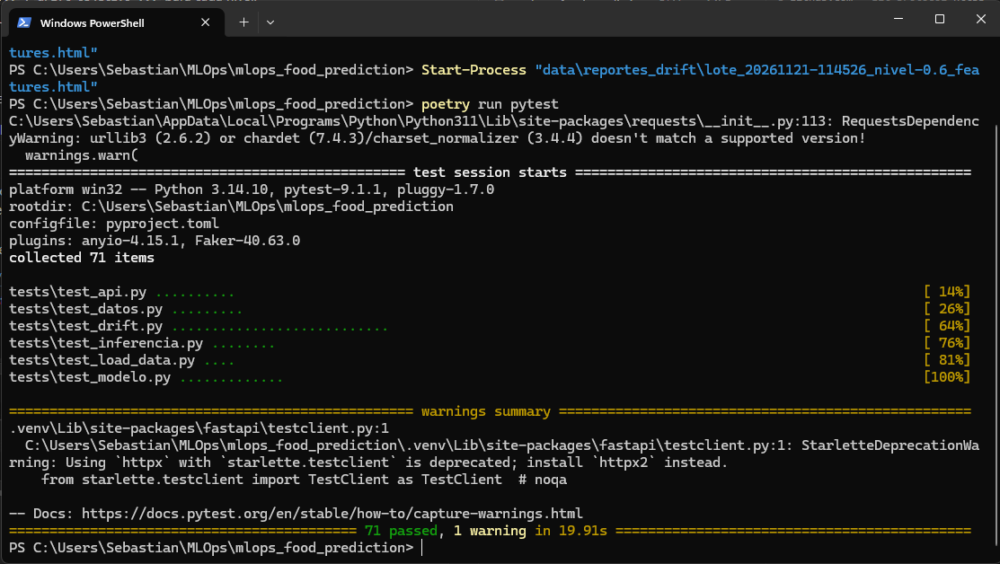
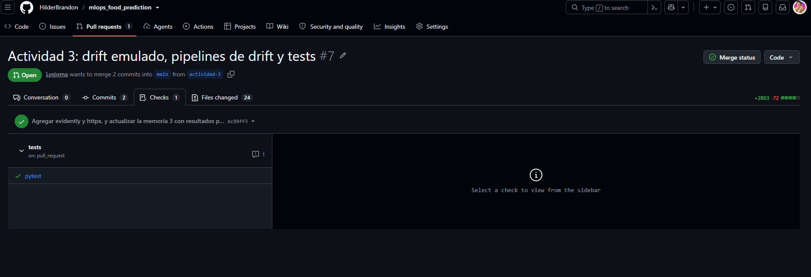

# Memoria 3: Drift y tests

**Proyecto:** Online Food Ordering Behavior Prediction · **Integrantes:** Brandon Galvis, Johan Sebastian Cuellar · **Repositorio:** https://github.com/HilderBrandon/mlops_food_prediction

> **Pendiente antes de entregar (borrar este recuadro):** las tablas de las secciones 6 y 7 tienen los valores de una réplica local del pipeline hecha con la copia pública del dataset, en la que `Customer Type` fue simulada. Hay que reemplazarlos por los de la ejecución propia (sección 8.2 del README) y añadir las capturas de la sección 6.

## 1. Objetivo

Añadir monitoreo al sistema de la actividad 2. La inferencia ahora puntúa lotes de la parte de prueba con un drift emulado de nivel configurable. Dos pipelines de Prefect comparan cada lote con los datos de entrenamiento: uno revisa las variables de entrada con Evidently y el otro la variable objetivo. Además se completa la batería de tests de datos, modelo, inferencia, API y drift, y se ejecuta en GitHub Actions.

## 2. Respuesta a la retroalimentación de la actividad 2

El profesor preguntó si las variables del modelo están disponibles en el momento de predecir. Al revisarlas una por una encontramos un problema con `Feedback`. Es la opinión que deja el cliente después de recibir el pedido, así que cuando hay que predecir si volverá a pedir todavía no existe. El modelo la estaba usando, y además está muy ligada al objetivo: el 75 % de los clientes con feedback negativo no vuelve a pedir, frente al 11 % de los que lo dejan positivo. En la práctica el modelo aprendía con información del futuro.

| Variable | ¿Disponible al predecir? | Decisión |
|---|---|---|
| Age, Gender, Marital Status, Occupation, Monthly Income, Educational Qualifications, Family size | Sí: datos del perfil del cliente | Se mantienen |
| Customer Type | Sí: sale del historial previo de pedidos | Se mantiene |
| latitude, longitude, Pin code | Sí: dirección de entrega | Siguen fuera de `CUSTOM`, como en la A2 |
| **Feedback** | **No: se conoce después del pedido** | **Excluida** |

Cambios:

- `configs/features.yaml` tiene una lista `excluidas`. Sus variables nunca entran en `ALL` ni en `NUMERIC`, y `CUSTOM` falla si alguna aparece. Un test comprueba que `Feedback` no llega al modelo.
- En la API, `Feedback` pasa a ser opcional y el modelo la ignora.
- El modelo se registra con un nombre nuevo, `food-modelo-sin-feedback`. Con el nombre anterior, la regla de promoción lo compara con el champion viejo (AUC 0,919, que usaba `Feedback`). Como el modelo honesto tiene menos AUC, nunca se promovería y la inferencia seguiría usando el modelo con fuga.

Para medir el efecto se entrenaron los cuatro candidatos con y sin `Feedback`, usando la misma partición:

| Candidato | AUC con Feedback | AUC sin Feedback |
|---|---|---|
| Regresión logística | 0,848 | 0,706 |
| **Random forest** | **0,915** | **0,882** |
| Gradient boosting | 0,914 | 0,861 |
| SVM | 0,911 | 0,830 |

El AUC baja en todos, sobre todo en los modelos lineales. El random forest sigue por encima del mínimo de 0,80. La cifra de la A2 era optimista: 0,88 es una estimación más honesta de lo que el modelo hará en producción.

## 3. Descripción del trabajo

1. **Partición compartida** (`src/datos.py`). `particionar()` hace la misma división estratificada del entrenamiento (`test_size` 0,25, semilla 42). Como `train_test_split` solo depende de la semilla y del objetivo, la inferencia y los pipelines de drift reconstruyen exactamente las mismas 291 filas de entrenamiento y 97 de prueba sin guardar archivos intermedios. Se comprobó que la partición es idéntica a la de la A2.
2. **Validación de datos** (`validar_datos()`): columnas esperadas, nulos, rangos de las numéricas y valores permitidos (`Gender`, `Output`). Las reglas están en `validacion` de `config.yaml`. Se ejecuta en la ingesta del entrenamiento y de la inferencia, y el flow falla si algo no cumple.
3. **Inferencia con drift emulado** (`flows/inferencia_flow.py`): `cargar_champion → ingesta → aplicar_drift → guardar_lote → predecir → guardar → registrar_inferencia`. El lote de 50 clientes sale de la parte de prueba, se le aplica el drift del nivel configurado y se guarda una copia con la etiqueta real en `data/lotes/`. Las predicciones se guardan sin la etiqueta.
4. **Drift de features** (`flows/drift_features_flow.py`, flow `drift-features`): `cargar_referencia → cargar_lote → calcular → guardar_reporte → alertar → registrar`. Usa `DataDriftPreset` de Evidently sobre las 8 variables del modelo y guarda un reporte HTML y un resumen JSON por lote.
5. **Drift de evento** (`flows/drift_objetivo_flow.py`, flow `drift-objetivo`): compara la tasa de `Output = Yes` del lote con la del entrenamiento mediante una prueba chi-cuadrado 2×2. Rechaza los lotes sin etiquetas.
6. **Alerta:** si la fracción de variables con drift supera `drift.umbral_fraccion` (0,3), el flow escribe un `WARNING` con `ALERTA` en el log de Prefect y lo incluye en su artefacto Markdown. Cada pipeline de drift también crea un run en MLflow (`fase = drift-features` / `drift-objetivo`).
7. **Despliegues:** `desplegar.py` añade `drift-features-diario` y `drift-objetivo-diario`, con cron `30 6 * * *`, media hora después de la inferencia.
8. **Tests y CI:** 5 archivos nuevos o ampliados en `tests/` y un workflow en `.github/workflows/tests.yml`.

Toda la lógica nueva está en `src/` (`datos.py`, `inferencia.py`, `drift.py`) y no importa Prefect ni MLflow. Los flows solo orquestan y registran.

## 4. Cómo se emula el drift

El nivel se fija en `drift.nivel` de `configs/config.yaml` y va de 0,0 a 1,0. No es un parámetro de ejecución. El escenario es plausible para una app de domicilios en Bangalore: la base de clientes deja de ser mayoritariamente de estudiantes y empiezan a llegar personas mayores, empleadas y con más ingresos, que además vuelven a pedir menos.

| Qué cambia | Regla (nivel `n`) | Con 0,3 | Con 0,6 |
|---|---|---|---|
| `Age` | la media sube `n × 2` desviaciones estándar | +0,6 desv. | +1,2 desv. (≈ +3,5 años) |
| `Family size` | la media sube `n × 1` desviación estándar | +0,3 desv. | +0,6 desv. |
| `Occupation` | una fracción `n` de las filas pasa a `Employee` | 30 % | 60 % |
| `Monthly Income` | una fracción `n` de las filas pasa a `More than 50000` | 30 % | 60 % |
| `Output` | una fracción `n × 0,5` de los `Yes` pasa a `No` | 15 % de los Yes | 30 % de los Yes |

Las numéricas enteras se redondean después del desplazamiento. Con `drift.semilla: 42` los tres niveles usan los mismos 50 clientes, así que las diferencias entre ellos solo vienen del drift. Para que el lote cambie en cada ejecución diaria se pone `semilla: null`.

## 5. Decisiones técnicas

| Decisión | Alternativas | Justificación |
|---|---|---|
| Reconstruir la partición con la misma semilla | Guardar `train.csv` y `test.csv` al entrenar | La partición es determinista y se comprobó que coincide con la de la A2. Evita archivos que pueden quedar desincronizados. |
| Referencia del drift = parte de entrenamiento | Dataset completo | Es lo que el modelo vio. Si se usara el dataset completo, la parte de prueba se compararía consigo misma. |
| KS para numéricas y chi-cuadrado para categóricas, p < 0,05 | Wasserstein, PSI | Con lotes de 50 filas las pruebas con p-valor tienen una lectura directa. Son las que Evidently elige por defecto con menos de 1.000 filas (para las binarias usaría la prueba z). Se dejan explícitas en el YAML para que el método no cambie si crece la referencia. |
| Alerta si la fracción con drift **supera** 0,3 | Alertar por cualquier variable | Con 8 variables y α = 0,05, es esperable que alguna salga marcada por azar. Pedir más de 2 de 8 filtra esos falsos positivos. |
| Chi-cuadrado 2×2 para el objetivo | Diferencia absoluta de tasas | Tiene en cuenta el tamaño del lote: con 50 filas, una tasa del 72 % frente al 77 % no es un cambio real. |
| Rechazar lotes sin etiquetas, usar las parciales | Calcular con lo que haya | Sin etiquetas el resultado no tiene sentido. Con etiquetas parciales se compara lo disponible y se avisa en el log. |
| La copia del lote lleva la etiqueta; las predicciones no | Un solo archivo | Así es en producción: la etiqueta llega días después y nunca debe llegar al modelo. |
| Evidently se importa dentro de `calcular_drift_features` | Importarlo al inicio de `src/drift.py` | El resto de la lógica de drift se prueba sin Evidently. |
| Modelo nuevo en el registry (`food-modelo-sin-feedback`) | Borrar el alias del champion viejo a mano | Es reproducible desde la configuración y deja trazado el cambio. |

## 6. Evidencias

**Prefect, inferencia con nivel 0,6.** El log muestra `Drift emulado nivel 0.6: tasa de 'Yes' …` y la ruta del lote guardado.

**Prefect, drift de features: alerta con 0,6.** `WARNING` con `ALERTA de drift de features` y la lista de variables.

**Evidently, reportes de 0,0 y 0,6.** Con 0,0 ninguna variable sale marcada. Con 0,6 salen `Age`, `Family size`, `Occupation` y `Monthly Income`.

| Nivel 0,0 | Nivel 0,6 |
|---|---|
|  |  |

**Prefect, drift de evento** y **MLflow** con los runs `fase = drift-features` / `drift-objetivo`.

**Tests.** `poetry run pytest` en local y el workflow en GitHub Actions.

## 7. Resultados

Lote de 50 clientes de la parte de prueba (`semilla` 42), comparado con las 291 filas de entrenamiento:

**Drift de features** (8 variables, umbral de alerta: más del 30 %)

| Nivel | Variables con drift | Fracción | Alerta |
|---|---|---|---|
| 0,0 | ninguna | 0 % | No |
| 0,3 | Age, Monthly Income | 25 % | No |
| 0,6 | Age, Family size, Occupation, Monthly Income | 50 % | **Sí** |

**Drift de evento** (α = 0,05; tasa de `Yes` en entrenamiento: 77,7 %)

| Nivel | Tasa de `Yes` en el lote | p-valor | Drift |
|---|---|---|---|
| 0,0 | 74,0 % | 0,698 | No |
| 0,3 | 62,0 % | 0,028 | Sí |
| 0,6 | 52,0 % | 0,0003 | **Sí** |

**Efecto en el modelo** (random forest sin `Feedback`, mismo lote)

| Nivel | Tasa predicha de `Yes` | Tasa real | Accuracy |
|---|---|---|---|
| 0,0 | 90 % | 74 % | 80 % |
| 0,3 | 98 % | 62 % | 60 % |
| 0,6 | 92 % | 52 % | 56 % |

**Lectura.** Los reportes de 0,0 y 0,6 son claramente distintos y solo el de 0,6 supera el umbral, que es lo que pide la actividad. Con 0,3 el detector de features marca 2 de 8 variables y no alerta, pero el de evento sí detecta la caída de la tasa. Los dos detectores se complementan: el cambio en el comportamiento de los clientes aparece antes que el cambio en sus características.

La última tabla muestra por qué hay que monitorear. Con drift, el modelo sigue prediciendo que casi todos vuelven a pedir (más del 90 %), mientras la tasa real cae al 52 % y la accuracy pasa del 80 % al 56 %. El modelo no lanza ningún error: simplemente se equivoca más. Sin estos pipelines, nadie lo notaría hasta revisar los resultados del negocio.

## 8. Tests

`poetry run pytest` no necesita MLflow, Prefect ni el CSV. La API se prueba con un modelo falso, reemplazando `cargar_champion` con `monkeypatch`.

| Archivo | Qué cubre |
|---|---|
| `test_datos.py` | Esquema, nulos, rangos, columnas numéricas con texto, valores permitidos, partición estratificada y reproducible, y el CSV real (se salta si no está) |
| `test_modelo.py` | Selección de variables, exclusión de `Feedback`, los 4 modelos y la regla de promoción |
| `test_inferencia.py` | El lote sale solo de la parte de prueba, reproducibilidad con semilla, puntuación y nombres de archivo |
| `test_api.py` | `/health`, `/predict` (Yes/No y columnas que recibe el modelo), `Feedback` opcional, 422 con datos inválidos y 503 sin modelo |
| `test_drift.py` | Emulación por nivel (0,0 no cambia nada, la tasa del objetivo baja), lectura del resultado de Evidently, umbral y alerta, rechazo de lotes sin etiquetas, drift de evento y una prueba con Evidently real en la que 0,0 no alerta y 0,6 sí |

## 9. Problemas encontrados

| Problema | Causa | Solución |
|---|---|---|
| Al quitar `Feedback`, el modelo nuevo no se promovía | La regla de promoción lo comparaba con el champion viejo, entrenado con fuga de información | Nombre nuevo en el registry: `food-modelo-sin-feedback` |
| En una primera versión del test de Evidently, con nivel 0,0 salía una variable marcada (p = 0,03) | Con 8 pruebas al 5 %, es esperable que alguna dé un falso positivo con datos sintéticos | Datos de prueba más grandes y una semilla elegida con margen (p ≥ 0,10 con 0,0 y ≤ 0,001 con 0,6). El umbral de fracción ya protege contra estos casos en el pipeline |

## 10. Conclusiones

Separar la lógica (`src/`) de la orquestación (`flows/`) permitió probar el drift, la inferencia y la API sin levantar servicios, y correr esos tests en GitHub Actions. La emulación muestra que el detector distingue un lote normal de uno con drift fuerte, y que el drift de evento detecta cambios que el de features no alcanza a marcar.

La retroalimentación de la A2 llevó al cambio más importante: quitar `Feedback`. El AUC del champion baja de 0,92 a 0,88, pero ese número corresponde a lo que el modelo puede hacer de verdad.

Con más tiempo: que una alerta lance el reentrenamiento, ajustar el umbral con más lotes reales y avisar por un canal externo (correo o Slack) en lugar de solo el log.

## 11. Uso de herramientas de IA

**Herramienta:** Claude (asistente de Anthropic).

**Para qué se usó:**

- Explicar los conceptos de drift de features y de evento, y revisar la retroalimentación de la A2.
- Escribir el código de `src/datos.py`, `src/inferencia.py`, `src/drift.py`, los dos flows de drift, los cambios de la inferencia y la API, los tests, el workflow de CI, la sección 8 del README y el borrador de esta memoria.
- Verificar la lógica con una réplica local y elegir los parámetros de la emulación.

**Qué se hizo sin IA:**

- La ejecución de los pipelines con los tres niveles, la revisión de los reportes de Evidently y la toma de capturas.
- La gestión del repositorio: rama, commits, Pull Request y revisión de la ejecución del CI.

**Qué se revisó o corrigió:**

- Que la partición reconstruida coincidiera con la de la A2.
- Que con 0,0 no hubiera alerta y con 0,6 sí, en los reportes de Evidently propios.

**Contribución individual:**

| Integrante | Contribución |
|---|---|
| Brandon Galvis | Guio el desarrollo con la IA. Ejecutó y validó los pipelines, tomó las capturas y gestionó el repositorio. |
| Johan Sebastian Cuellar | Revisó la implementación y la memoria, y se encarga de la entrega final. |
